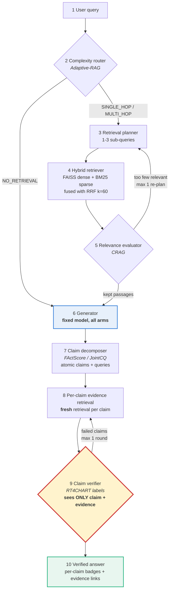

# Self-Verifying Agentic RAG

**Claim-Level Hallucination Detection in an Agentic Retrieval Pipeline**

NLP Mini-Project · Aditya Khairnar (C221) · 3rd year B.Tech AIML

A retrieval-augmented question-answering system that **plans its own
retrieval** and then **audits its own answer**. The draft answer is decomposed
into atomic claims; each claim is independently checked against retrieved
evidence and labelled ENTAILED / CONTRADICTED / UNSUPPORTED with a link to the
evidence span that decided it. Failed claims trigger targeted re-retrieval and
regeneration of **only those claims**, not a full restart.

> **New here? Read [`START_HERE.md`](START_HERE.md) first** - five commands to
> a running system. Then [`ANALYSIS.md`](ANALYSIS.md) for what it found.

---

## Architecture



The highlighted verifier node is where this project differs from prior work:
it is given **only the claim and the evidence**, never the draft answer or the
generator's reasoning. See *Information asymmetry* below.

---

## The ablation

Three arms, **the same generator model in all three**, so the experiment
measures the pipeline and not the model.

| Arm | What it is | Router | Planner | Relevance | Verification |
|---|---|---|---|---|---|
| **A** | Baseline RAG - retrieve once, generate once | - | - | - | - |
| **B** | Agentic only - planning and corrective retrieval | yes | yes | yes | - |
| **C** | Full system, deletes claims that fail | yes | yes | yes | **yes** |
| **D** | Full system, **warn-only**: keeps and badges failed claims | yes | yes | yes | **yes** |

Arms C and D differ in exactly one flag, `drop_failed`. **Arm D is the
recommended configuration** - see `ANALYSIS.md` section 10.

The arms are **flag sets over one implementation** (`src/config.py` -> `ARMS`),
not three separate code paths. If arm C had its own code, any difference could
be an artefact of that code rather than of verification.

Arms A and B run verification in **shadow mode**: verdicts are recorded for
measurement but never acted on, so faithfulness is comparable across all three
arms. Shadow calls are excluded from each arm's reported cost.

---

## Information asymmetry

The claim verifier never sees the draft answer, the question, or the
generator's reasoning - only `(claim_text, evidence_passages)`.

**Why.** MARCH (Li et al. 2026) shows a model asked to check its own output
reproduces its own errors: shown its reasoning, it finds that reasoning
persuasive and confirms the mistake. Withholding the generator's output breaks
that loop - the verifier has nothing to agree with, so it must read the
evidence.

**Enforced three ways:** a function signature with no parameter for the draft,
a runtime guard (`assert_asymmetry`), and `tests/test_asymmetry.py`, which
fails the build if either is removed.

```bash
pytest tests/test_asymmetry.py -q    # the executable proof
```

---

## Results

Full discussion in [`ANALYSIS.md`](ANALYSIS.md); numbers in
`runs/<latest>/ablation_table.md` and `cost_latency_table.md`.

| | A baseline | B agentic | C full, delete | D full, warn-only |
|---|---|---|---|---|
| Exact match (span) | **0.265** | 0.245 | 0.204 | 0.204 |
| Token F1 (span) | **0.355** | 0.323 | 0.266 | 0.282 |
| LLM-judge correct | 0.429 | 0.367 | 0.367 | **0.449** |
| Faithfulness | 0.753 | 0.753 | **0.788** | **0.788** |
| Tokens / query | **857** | 2,775 | 4,353 | 4,353 |

EM and F1 are scored on the short answer **span**, as HotpotQA intends - its
gold answers average 2.8 words while this generator writes sentences, so
sentence-level EM measures formatting rather than correctness (`ANALYSIS.md`
section 11). Both are reported in the run's tables.

Three findings, all argued in full in `ANALYSIS.md`:

- **Claim-level verification improves faithfulness** (C and D over B, which
  shares their retrieval), at roughly 5x the tokens.
- **Deleting a flagged claim is what costs accuracy, not verifying it.**
  Measured verifier precision is 0.247, so most flags are false positives;
  arm D keeps the claim and badges it instead, retaining the whole
  faithfulness gain at the same cost. **Arm D is the recommended
  configuration.**
- **A purpose-built NLI cross-encoder did not fix precision** - it was worse
  (0.173). Both backends over-flag against a true 12% hallucination rate, so
  the ceiling is the task formulation rather than the model.

One result worth stating up front, because it justifies a design choice -
retrieval recall@5 over 30 questions:

| Retriever | recall@5 |
|---|---|
| Dense only (bge-small + FAISS) | 0.817 |
| Sparse only (BM25) | 0.717 |
| **Hybrid (RRF fusion)** | **0.833** |

Fusion beats both, which is the empirical justification for running two
retrievers rather than one.

---

## Reproduce

```bash
# setup
uv venv --python 3.11 && source .venv/bin/activate
uv pip install -r requirements.txt
cp .env.example .env            # paste your OpenRouter key

# data (no API key needed)
python -m src.data.build_hotpot      # 100 eval questions + 9,735 passages
python -m src.data.build_ragtruth    # 50 human-labelled responses
python -m src.data.build_index       # FAISS + BM25

# verify
pytest -q
python -m src.run_eval --arm all --n 3 --mock     # free plumbing check

# the experiment
python -m src.run_eval --arm all --n 100          # ~$3
python -m src.run_ragtruth                        # verifier vs human labels
python -m src.report                              # tables + plots

# demo
streamlit run src/app.py
```

Everything is seeded (`seed: 42` in `config.yaml`) and every LLM call is
cached to disk, so a re-run after a bug fix costs nothing.

---

## Stack

| Layer | Choice | Why |
|---|---|---|
| Orchestration | Plain Python, explicit stages | Every control-flow decision is a line you can point at; LangChain's chain abstractions express cyclic corrective loops awkwardly |
| LLM gateway | Provider map in `config.yaml` | `ollama` / `gemini` / `openrouter`, switched by one flag; nothing downstream knows which is active |
| Provider | Ollama (local) by default | Free-tier request caps elsewhere (50/day, 20/day) could not cover ~1,150 calls per run |
| Generator | `qwen2.5:7b-instruct` | Fixed across all arms. Non-reasoning: Qwen3/Gemma4 spend thousands of characters thinking first (~83s/call) |
| Helper stages | same model | Switchable with one flag: `--provider openrouter` runs the whole stack on Claude Sonnet 5 |
| Dense retrieval | `BAAI/bge-small-en-v1.5` + FAISS `IndexFlatIP` | Exact search is sub-millisecond at 10k passages |
| Sparse retrieval | `rank_bm25` | Standard, pure Python, no infrastructure |
| Fusion | Reciprocal Rank Fusion (k=60) | Score-scale-free, so no per-query normalisation |
| Evaluation | HotpotQA official EM/F1 + LLM judge + RAGTruth | ARES would require *training* judge models with human validation |
| Demo | Streamlit | Fastest route to the per-claim evidence view |

---

## Data

| Dataset | Use | Size |
|---|---|---|
| `hotpotqa/hotpot_qa` (distractor, validation) | Multi-hop QA + retrieval corpus | 100 eval questions, 9,735 indexed passages |
| `wandb/RAGTruth-processed` (test, QA) | Human span labels for verifier P/R | 25 hallucinated + 25 clean |

Both from Hugging Face. No personal data.

---

## Repository layout

```
config.yaml           every tunable setting
src/
  config.py           typed config + the three ablation arms
  types.py            Route, Verdict, Claim, Evidence, StageLog, PipelineResult
  llm.py              OpenRouter client + disk cache + cost accounting
  data/               dataset and index builders
  retrieval/          dense.py, sparse.py, hybrid.py (RRF)
  stages/             the 10 pipeline stages, one file each
  prompts/            one .txt per LLM stage, version-controlled
  pipeline.py         the orchestrator - START HERE when reading the code
  run_eval.py         the ablation
  run_ragtruth.py     verifier vs human labels
  metrics.py          EM/F1, faithfulness, claim P/R, cost, latency
  report.py           tables + plots
  app.py              Streamlit demo
tests/                one file per milestone
```

---

## Scope

**In:** text-only, English, single corpus, max 2-3 retrieval hops, one
correction round, 100-question controlled eval, one fixed LLM across arms.

**Out, and named as such:** NLI-cross-encoder verifier comparison,
SelfCheckGPT sampling consistency, 2WikiMultiHopQA, a legal/medical domain
corpus, RL-trained retrieval policies, knowledge-graph grounding, production
deployment.

---

## References

1. Jeong et al. (2024). *Adaptive-RAG.* NAACL. arXiv:2403.14403
2. Yan et al. (2024). *Corrective Retrieval Augmented Generation.* arXiv:2401.15884
3. Asai et al. (2023). *Self-RAG.* ICLR 2024. arXiv:2310.11511
4. Min et al. (2023). *FActScore.* EMNLP. arXiv:2305.14251
5. Xu et al. (2025). *JointCQ.* arXiv:2510.19310
6. Niu et al. (2024). *RAGTruth.* arXiv:2401.00396
7. Manakul et al. (2023). *SelfCheckGPT.* EMNLP. arXiv:2303.08896
8. Li et al. (2026). *MARCH.* arXiv:2603.24579
9. Mishra (2026). *CHARM.* arXiv:2606.04435
10. Cormack et al. (2009). *Reciprocal Rank Fusion.* SIGIR
